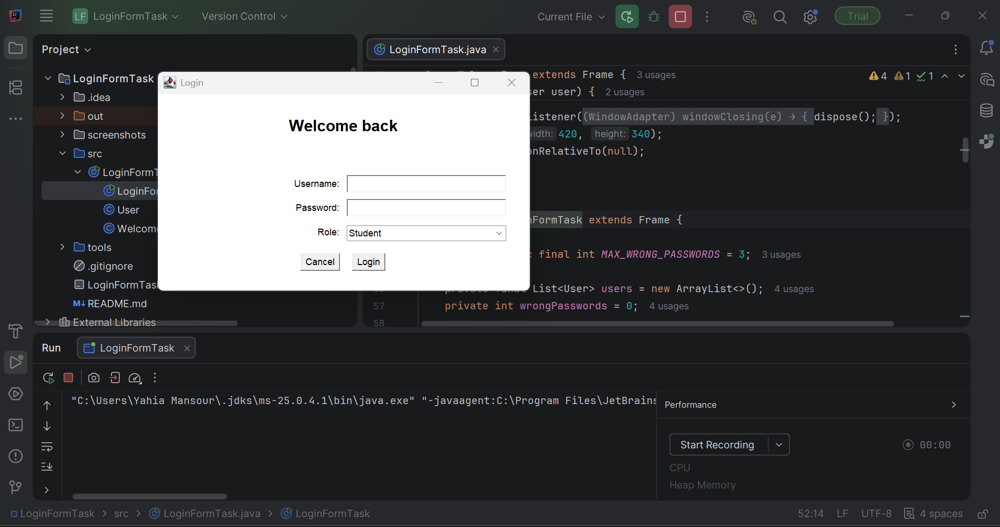
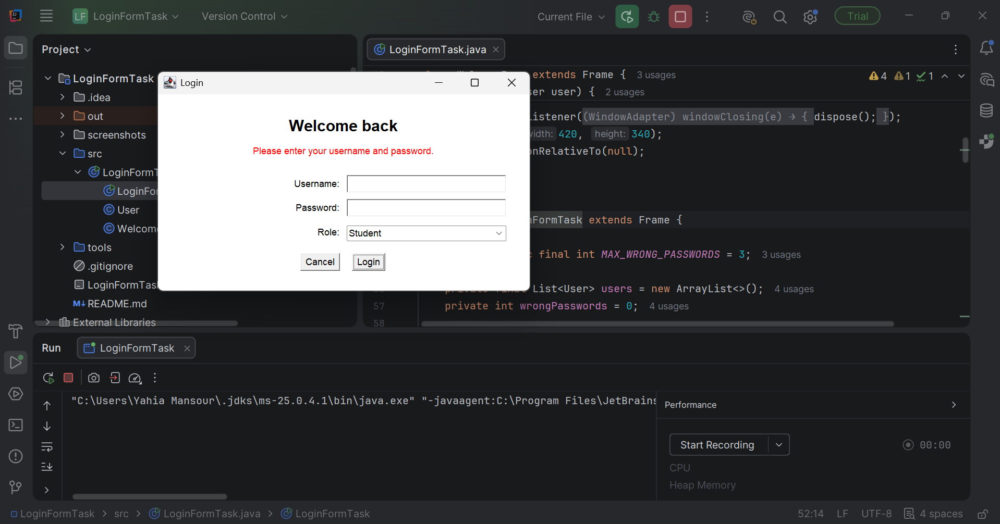
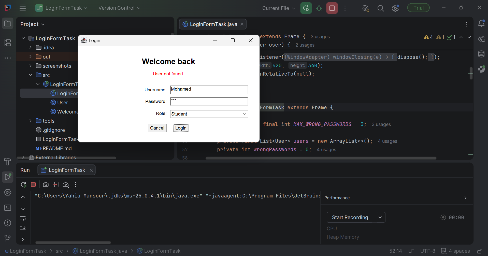
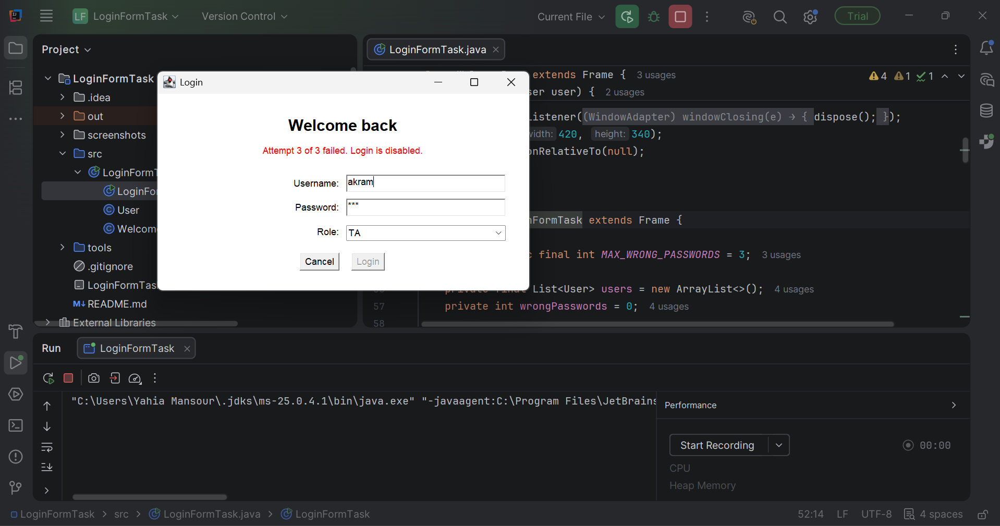
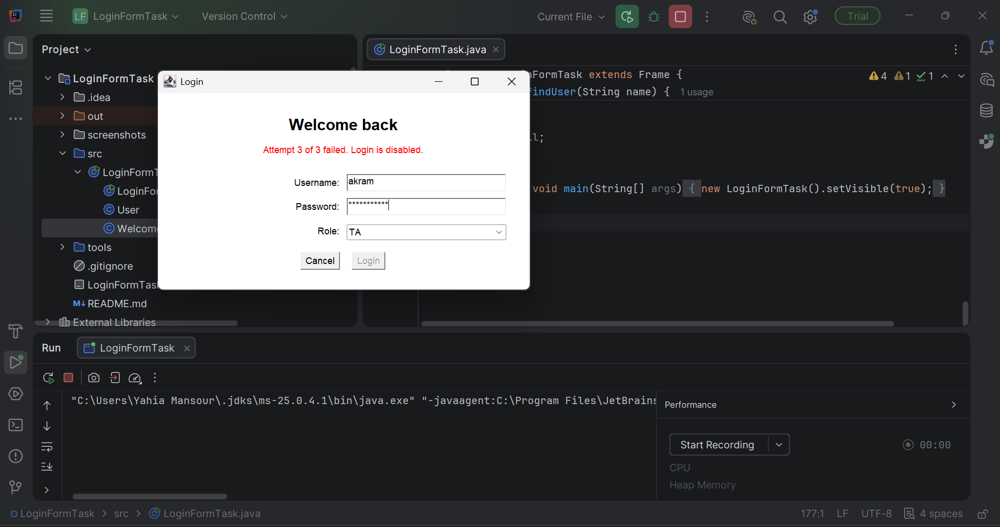
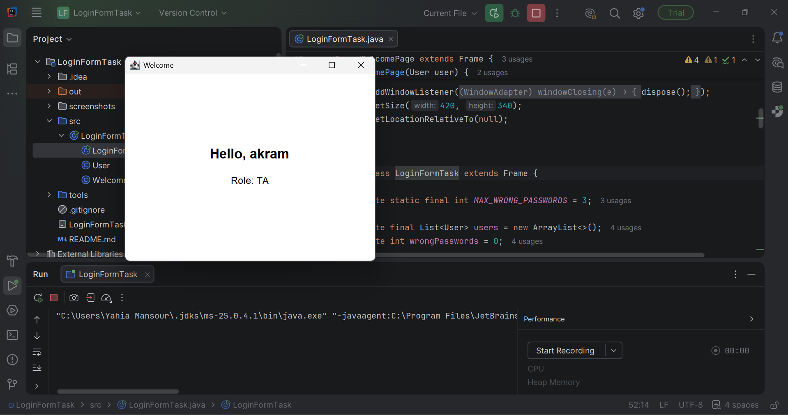
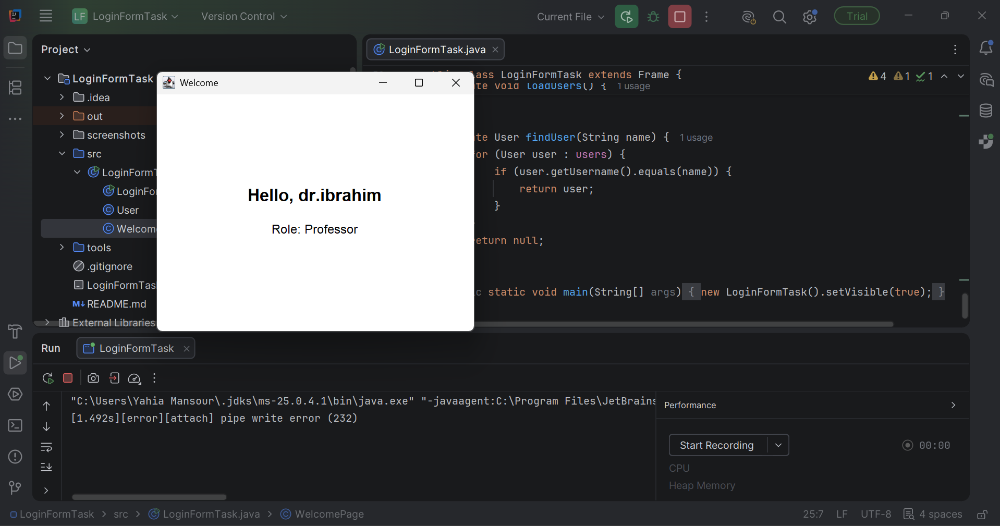

# Login Form Task

A simple login form built with Java AWT. The users are hard-coded and the Login button gets disabled after 3 wrong passwords.

## Project structure

```
src/
└── LoginFormTask.java    # User, WelcomePage and LoginFormTask classes
screenshots/              # Screenshots of each scenario
```

## Test users

| Username   | Password   | Role      |
|------------|------------|-----------|
| yahia      | student123 | Student   |
| akram      | ta123      | TA        |
| dr.ibrahim | prof123    | Professor |

## How it works

1. If the username or password is empty, a message tells which one is missing.
2. If the username does not exist, it shows `User not found.`
3. If the password is wrong, it shows `Incorrect password. Attempt N of 3.`
4. If everything is correct, the Welcome page opens with the username and role.

After 3 wrong passwords the Login button is disabled. Empty fields and unknown usernames do not count as attempts.

## Run

```bash
javac -d out src/LoginFormTask.java
java -cp out LoginFormTask
```

## Screenshots

| Scenario | Screenshot |
|----------|------------|
| Initial form |  |
| Both fields empty |  |
| Password empty |  |
| Username empty |  |
| User not found |  |
| Wrong password (1st) |  |
| Wrong password (2nd) |  |
| 3rd wrong password, Login disabled |  |
| Correct password after lock, still disabled |  |
| Student login |  |
| TA login |  |
| Professor login |  |
